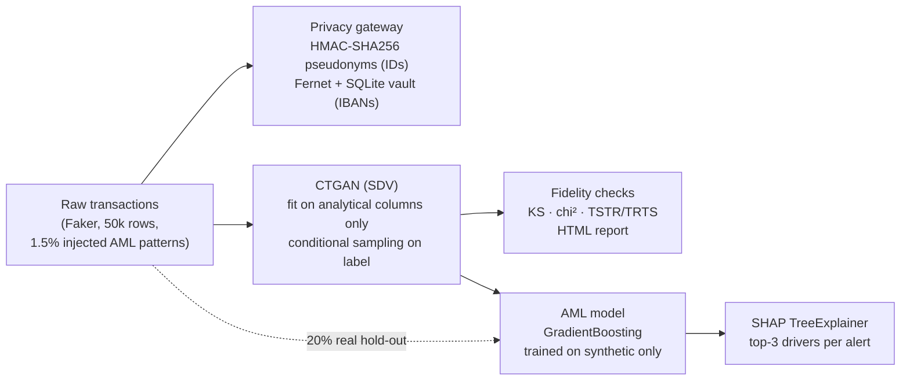

# Privacy-First Banking Compliance Layer

Proof of concept: pseudonymise and tokenise bank transactions, generate a synthetic copy with CTGAN, and train an explainable AML model on synthetic data only.

[](https://github.com/AdityaShekhawat0504/Privacy-First-Banking-Compliance-Layer-/actions/workflows/ci.yml)
[](LICENSE)

## Why it matters

AML teams need rich transaction data, but customer identifiers and IBANs are personal data under GDPR and should not leave the bank's systems. Data scientists and vendors usually get either too little data or too much PII. This project tests one way out: strip identity at a gateway, train models on a synthetic surrogate, and attach a per-alert explanation that a compliance officer can audit.

## How it works



1. **Privacy gateway** (`privacy/`). Join keys (customer, counterparty, transaction IDs) become one-way HMAC-SHA256 digests with a separate key per domain. IBANs become random UUID tokens; the plaintext is Fernet-encrypted in a SQLite vault with an audit log, so it can be recovered under legitimate authority (for example a SAR filing).
2. **Synthesis** (`synthesis/generate.py`). Identifier columns are dropped before CTGAN is fitted, so the generator never sees them. Conditional sampling keeps the suspicious-label rate equal to the real rate.
3. **Validation** (`synthesis/validate.py`). KS tests for numeric columns, chi² tests for categorical columns, and TSTR/TRTS AUC as a utility check.
4. **Detection** (`detection/`). A GradientBoosting model with rule-style features (round amounts, near-10k structuring band, high-risk country, sender velocity) is trained on synthetic data and evaluated on a real hold-out. SHAP gives the top three drivers for each alert.

See [docs/ARCHITECTURE.md](docs/ARCHITECTURE.md) for components, data flow and design decisions.

## Results

All numbers come from one run with `random_state=42` on 50,000 Faker-generated "real" rows and 50,000 CTGAN rows (100 epochs). Sources: `reports/validation_report.html`, `reports/top_alerts.csv`, and `notebooks/demo.ipynb`.

**AML detection** (from `make train`, reported in the demo notebook; evaluated on the 20% real hold-out, 10,000 rows)

| Training data | ROC AUC |
|---|---|
| Synthetic only (privacy-preserving path) | 0.806 |
| Real training split (ceiling, no privacy) | 0.931 |

The synthetic-trained model keeps about 87% of the ceiling AUC. The 0.125 gap is the cost of never training on real records. The top-20 alerts in `reports/top_alerts.csv` all score between 0.994 and 0.997, and each carries three signed SHAP contributions.

**Synthetic data fidelity** (from `make synth`, `reports/validation_report.html`)

| Check | Result |
|---|---|
| TSTR AUC (train synthetic, test real) | 0.8288 |
| TRTS AUC (train real, test synthetic) | 0.7176 |
| TSTR/TRTS ratio (project threshold 0.85) | 1.155, pass |
| KS `hour_of_day` / `day_of_week` (pass if D < 0.1) | D = 0.0086 / 0.0042, pass |
| KS `amount_eur` | D = 0.1437, fail |
| chi² `is_suspicious` | 0.00 (p = 1.0), pass: label rate 1.51% in both sets |
| chi² `currency`, `channel`, `country_code`, `merchant_category` | fail (p < 0.0001) |
| Overall verdict in the report | FAIL |

Read this honestly: the synthetic data is useful for training (TSTR passes), but its marginal distributions do not match the real data on amounts and four of five categorical columns. A TSTR/TRTS ratio above 1 here is driven by a low TRTS score, which suggests the synthetic distribution differs from the real one. The 0.85 threshold is this project's choice, not a regulatory number.

**Tests**: 29 tests in `tests/` (privacy gateway, feature engineering, metrics, training, SHAP output, validation, report, data generator). They run on CPU in a few seconds and run in CI on every push.

## Quickstart

Needs Python 3.11+ and [uv](https://docs.astral.sh/uv/). The first `uv sync` downloads PyTorch (a CTGAN dependency), which is large.

```bash
git clone https://github.com/AdityaShekhawat0504/Privacy-First-Banking-Compliance-Layer-.git
cd Privacy-First-Banking-Compliance-Layer-
uv sync --all-groups          # or: make install

make lint                     # ruff
make test                     # pytest, no keys or data needed
```

Full pipeline (writes to `data/`, `models/`, `reports/`; CTGAN with 100 epochs takes about 15 minutes on CPU):

```bash
make data      # 50k Faker transactions        -> data/raw/transactions.csv
make synth     # CTGAN + validation report     -> data/synth/, reports/validation_report.html
make train     # synthetic-trained AML model   -> models/aml_model.joblib
make explain   # top-20 alerts with SHAP       -> reports/top_alerts.csv
make demo      # open notebooks/demo.ipynb
```

The privacy gateway reads its keys from environment variables. The notebook loads `.env` if it exists and falls back to demo keys otherwise. For your own keys:

```bash
cp .env.example .env
openssl rand -hex 32   # once each for HMAC_KEY_CUSTOMER, HMAC_KEY_COUNTERPARTY,
                       # HMAC_KEY_ACCOUNT, HMAC_KEY_TRANSACTION, VAULT_INDEX_KEY
uv run python -c "from cryptography.fernet import Fernet; print(Fernet.generate_key().decode())"  # VAULT_KEY
```

`pip install -e .` also works if you prefer pip; dependency versions are then not pinned by `uv.lock`.

## Tech stack

Python 3.11, uv, pandas, NumPy, Faker, SDV / CTGAN (PyTorch), scikit-learn, SHAP, SciPy, cryptography (Fernet), SQLite, matplotlib, Jupyter, pytest, ruff, GitHub Actions.

## Project structure

```
src/privacy_aml/
  privacy/      pseudonymise.py (HMAC), tokenise.py (vault), pipeline.py (apply both)
  data/         generate_fake.py   Faker data with injected AML patterns
  synthesis/    generate.py (CTGAN), validate.py (KS, chi², TSTR/TRTS)
  detection/    train.py (features, model), explain.py (SHAP)
  reports/      html.py            validation report
notebooks/demo.ipynb               end-to-end walkthrough
reports/                           committed outputs from the reference run
tests/                             pytest suite
docs/ARCHITECTURE.md               design notes
```

## Limitations and next steps

- **The "real" data is synthetic.** It is generated by Faker with hand-coded suspicious patterns, so the model mostly rediscovers those rules. Real labels would come from historical SAR records.
- **Fidelity is weak.** The overall validation verdict is FAIL: `amount_eur` (heavy tail) and four categorical columns do not match. Next step: try SDV's GaussianCopula or per-band models for amounts and tune CTGAN.
- **The gateway is not chained into the `make` pipeline.** `make synth` fits CTGAN on the raw table with identifier columns dropped; `apply_privacy` is exercised in tests and the notebook. Wiring it into the batch pipeline is the obvious next step.
- **Velocity needs streaming state in production.** `sender_txns_per_day` is computed within a batch; real-time scoring would need a keyed store (for example Redis or Flink state).
- **No formal privacy guarantee for the synthetic data.** No differential privacy and no membership-inference testing yet.
- **Regulatory mapping is a design intent, not a legal opinion.** The design targets GDPR Art. 4(5) and Art. 25 and the explainability expectations of EBA and BaFin; it has not been reviewed by a regulator or lawyer.
- **Not built:** HSM key management, Kafka ingestion, format-preserving encryption, graph models, federated learning, goAML reporting.

## License

MIT, see [LICENSE](LICENSE). No real bank data or customer records are included.
