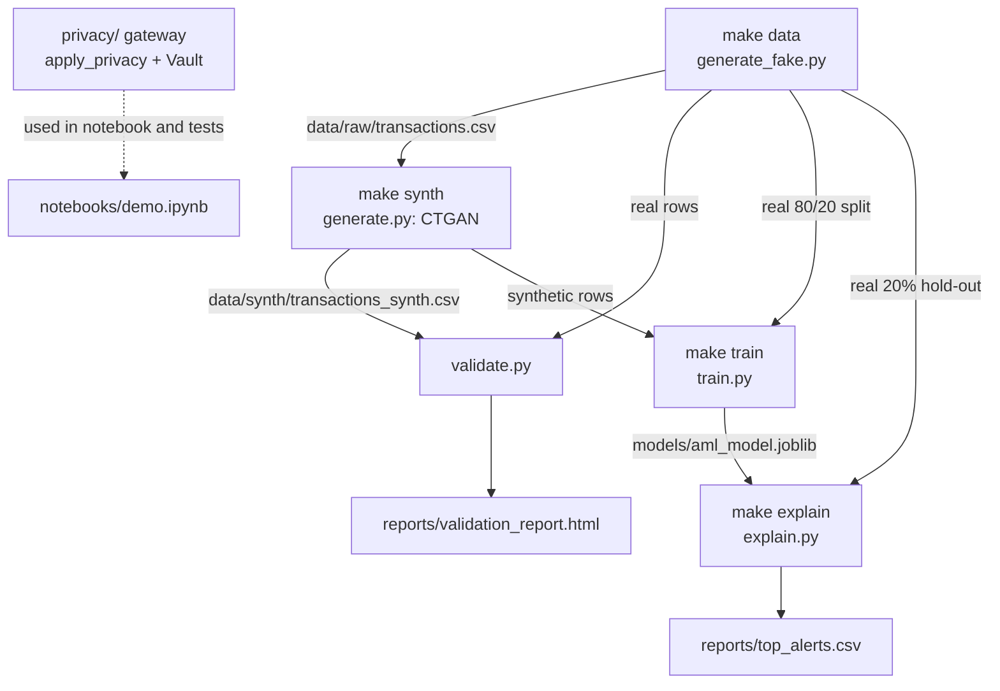

# Architecture

This is a batch proof of concept. Every stage is a Python module under `src/privacy_aml/` with a `__main__` block, driven by the `Makefile`. Stages talk to each other through CSV and joblib files on disk.

## Components

| Component | Module | Responsibility |
|---|---|---|
| Data generator | `data/generate_fake.py` | Builds 50,000 raw transactions with Faker (5,000 senders, 8,000 receivers, 90 days). Injects about 1.5% suspicious rows in four patterns: round amounts, transfers to high-risk countries (KY, PA, VG), velocity spikes (10 transactions from one sender in a day), and structuring (3 to 5 transfers of 9,000 to 9,999.99 EUR within 48 h). `verify_patterns` checks that every pattern is present. |
| Pseudonymiser | `privacy/pseudonymise.py` | One-way HMAC-SHA256 with a separate key per domain (`customer`, `counterparty`, `account`, `transaction`), read from environment variables. Same input and domain always gives the same 64-char digest. |
| Tokenisation vault | `privacy/tokenise.py` | `Vault` class on SQLite. Maps IBANs to random UUID tokens, stores the plaintext only as Fernet ciphertext, deduplicates through an HMAC index with its own key, rejects reversal under the wrong domain, and logs every insert, lookup and reverse in an `audit` table. |
| Privacy pipeline | `privacy/pipeline.py` | `apply_privacy(df, vault)` pseudonymises the three ID columns, tokenises both IBAN columns, and passes the analytical columns through unchanged. |
| Synthesiser | `synthesis/generate.py` | Drops identifier columns, derives `hour_of_day` and `day_of_week`, fits SDV's `CTGANSynthesizer` on CPU, and samples with one condition per label value so the suspicious rate matches the real data. Timestamps, IDs and IBANs are regenerated afterwards and have no link to real rows. |
| Validator | `synthesis/validate.py` | KS test per numeric column (pass if D < 0.1), chi² goodness of fit per categorical column (pass if p > 0.05), and TSTR/TRTS: GradientBoosting trained on synthetic and scored on real, and the reverse. Pass if TSTR/TRTS ≥ 0.85 (project threshold). |
| Report | `reports/html.py` | Single-file HTML report with embedded matplotlib charts and a table of every test. |
| Detector | `detection/train.py` | `build_features` (amount, time, round-amount flag, near-10k flag, high-risk-country flag, cross-border flag, sender transactions within ±12 h, one-hot channel/currency/merchant category). `train` fits a balanced GradientBoosting model (200 trees, depth 4) on synthetic data, a real-trained baseline on the real 80% split, and evaluates both on the real 20% hold-out (AUC, precision and recall at the top 1%, confusion matrix). |
| Explainer | `detection/explain.py` | SHAP `TreeExplainer` on the saved model; returns probability and the top-k features by absolute SHAP value for each row. The CLI writes the top-20 alerts to `reports/top_alerts.csv`. |

## Data flow

The privacy gateway is a separate, tested library. In the current batch pipeline CTGAN is fitted on the raw table with identifier columns dropped; it does not consume the gateway's output. In the target design the gateway sits at the bank's trust boundary and every downstream stage only sees pseudonymised records.

The train/test split uses `train_test_split(test_size=0.2, random_state=42, stratify=is_suspicious)` in `validate.py`, `train.py` and `explain.py`, so all three score the same real hold-out.

## Key design decisions

**Two privacy mechanisms, kept separate.** Join keys must stay stable for aggregation ("all transfers from sender X") and should never be reversible, so they get HMAC digests. IBANs may legitimately need unmasking (SAR filing, supervisor requests, correspondent-bank queries), so they get vault tokens that only the key holder can reverse. One reversible scheme for both would make join keys re-identifiable; one irreversible scheme would block legitimate IBAN recovery.

**Per-domain keys.** The same raw value hashed under `customer` and `counterparty` gives unrelated digests, so leaked analytics tables from different domains cannot be joined on the digest.

**Separate vault keys.** The Fernet key encrypts IBANs and a different HMAC key builds the dedup index, so leaking one key does not expose both the mapping and the plaintext.

**Synthesise analytical columns only.** CTGAN never sees IDs or IBANs, so no attack on the generator can recover them. It can still leak information about the analytical columns; that risk is not measured yet.

**Conditional sampling for the label.** With a 1.5% base rate, unconditioned CTGAN sampling can drift on the minority class. Sampling `n × rate` positive and `n × (1 − rate)` negative rows fixes the prior the detector learns from.

**Train on synthetic, evaluate on real.** The detector never trains on a real row. The real-trained baseline on the 80% split shows what is given up; the AUC gap is the measured cost of the privacy constraint.

**Gradient boosting over deep models.** 200 shallow trees train in seconds on 50,000 rows, and SHAP's `TreeExplainer` gives exact Shapley values for tree ensembles. Each alert can be explained feature by feature, which matters more here than a few points of AUC.

**Timestamps normalised to nanoseconds.** The velocity window is computed in integer nanoseconds. The code casts to `datetime64[ns]` first because pandas 3 may parse timestamps at second or microsecond resolution.

## Regulatory intent

The design is aimed at, not certified against, these requirements:

- GDPR Art. 4(5) pseudonymisation: identifiers are replaced with keyed digests and the keys stay with the bank.
- GDPR Art. 25 data protection by design: the analytics side receives no plaintext identifiers or IBANs.
- EBA expectations on ML in AML/CFT: synthetic training data is checked for representativeness (KS, chi², TSTR/TRTS) before use.
- BaFin expectations on explainability: each alert carries its top three signed SHAP contributions.

## Not in scope

HSM or FIPS 140-3 key management, streaming ingestion (Kafka), format-preserving encryption, differential privacy, membership-inference testing, graph models on the transaction network, federated learning, and goAML or XBRL reporting.
